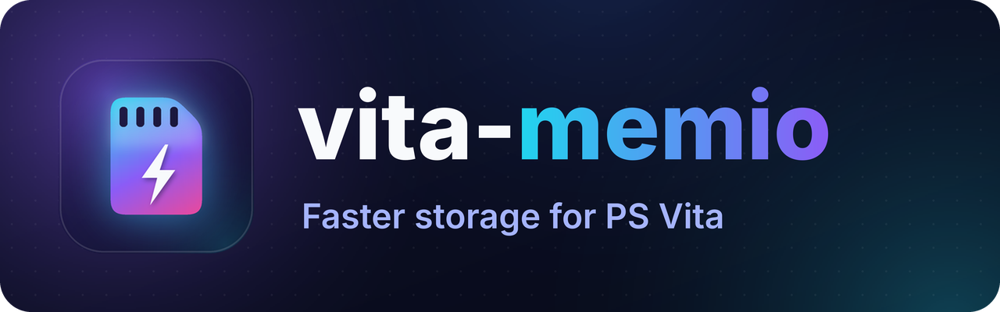

# vita-memio

<p align="center"></p>

Makes the PS Vita read and write its storage faster: a microSD in an SD2Vita, the Sony memory card and the internal storage. It is a taiHEN plugin for HENkaku/Ensō on firmware **3.65**.

On my console a microSD in an SD2Vita reads **19.6 MiB/s instead of 13.5** (+45%) and writes about 15–17 MiB/s. VitaShell copies, VPK installs and anything else that moves big files get faster, and nothing about your files changes: the data on the card is exactly what it would be without the plugin. Most game loading is not limited by storage speed, so expect a smaller gain there than in a file copy.

vita-memio is a fork of **[Vita Turbo Storage](https://github.com/juanjsebgarcia/vita-turbo-storage)** by [Juan Garcia Alvite](https://github.com/juanjsebgarcia). The idea, the research and the original implementation are his. This fork adds a few speed-ups of its own, a Settings page, a HUD and a tester app.

## What the plugin does

vita-memio sits between the system's storage driver and the program that reads or writes. For large transfers on a storage you have switched on, it arranges the transfer so the driver finishes it sooner. The system's driver itself is never modified: it still sends every command, handles every error and moves the data.

- **The storage works exactly as before.** What a program reads is byte-for-byte what it would read without the plugin, and what it writes ends up on the card unchanged.
- **Writes are never cached or delayed.** When a write returns, the data is on the card, just like without the plugin.
- **Anything unusual falls back to normal.** An error switches that storage back to the standard path for the rest of the session and finishes the request the standard way. On a firmware it does not know, the plugin installs nothing at all.
- **Small transfers are left alone** (under 32 KiB: mostly the file system's own bookkeeping), unless you switch on *Small transfers too*.
- **Only the three storages below are touched,** and only while switched on: a microSD in an SD2Vita, the Sony memory card and the internal storage. Game cards, USB storage and Wi-Fi never are.

**Cached and non-cacheable memory.** A program reads into a buffer, and that buffer is in one of two kinds of memory:

- **Ordinary (cached) memory**, where most program data lives: file copies, installs, most of what a game loads. These reads get the speed-up described below.
- **Non-cacheable memory**, which a program sets aside for data the graphics chip reads directly. The system already reads into it at full speed, so the plugin leaves these reads exactly as they are: same speed, no change at all. The tester shows them as the **NC** rows.

The plugin decides this per read, from the buffer itself, so the same program can do both in one session. Which kind a given program uses for a given file is up to that program.

**About GPU-safe reads.** They matter only for reads into ordinary memory. What your program reads is always identical to the normal way. With **GPU-safe reads** on, the data also ends up in memory exactly as the normal way leaves it, so the graphics chip always sees it correctly, even if a program hands data to it without any extra step. It costs a little speed (see below) and is the recommended choice while playing. With it off, the data is the same, but it can still sit in the processor's cache for a moment: a program that loads a file straight into memory the graphics chip reads, without flushing, could in principle draw a stale texture. Nothing on the card is affected either way.

## Performance

My console: PCH-1000 on firmware 3.65, my own microSD in an SD2Vita (`ux0:`), the official Sony memory card (`uma0:`) and the internal storage (`ur0:`). Measured with the included tester (quick profile: a 16 MiB file, three runs, every byte checked), with *Overlapped reads* on *Auto*.

**SD2Vita (microSD) reads**

| Request size | Without plugin | GPU-safe reads off | GPU-safe reads on |
|---|---:|---:|---:|
| 1 MiB | 13.5 MiB/s | **19.6 MiB/s** | **18.8 MiB/s** |
| 128 KiB | 12.9 MiB/s | **18.1 MiB/s** | **16.8 MiB/s** |

**Compared with the original project's published figures**

| Test | Original: stock | Original: Turbo Storage | vita-memio (my console) |
|---|---:|---:|---:|
| SD2Vita reads, 1 MiB | 13.3 MB/s | 16.8 MB/s | **19.6 MiB/s** |
| SD2Vita reads, 128 KiB | 12.4 MB/s | 15.7 MB/s | **18.1 MiB/s** |
| SD2Vita writes | 4.4–5.4 MB/s | 6.0–6.3 MB/s | **14.5–17.5 MiB/s** |
| Sony memory card reads, 1 MiB | 10.5 MB/s | 13.8 MB/s | **14.1 MiB/s** |
| Sony memory card writes, 1 MiB | 9.1 MB/s | 10.0 MB/s | **13.2–13.8 MiB/s** |
| Internal storage reads | 14.2–15.5 MB/s | 19.0–21.1 MB/s | **19.2–21.3 MiB/s** |
| Internal storage writes | 7.4–8.1 MB/s | 8.2–8.8 MB/s | **7.6 MiB/s** |

- **What loading costs the game's own CPU core** (measured with the tester's core meter, SD2Vita, GPU-safe reads on), in ms of its time per MiB read:

  | Reads of | Copy on the game's core | *Copy on the system core*: Always (default) |
  |---|---:|---:|
  | 1 MiB | 22 | **3** |
  | 128 KiB | 25 | **5** |
  | 32 KiB | 37 | **16** |
  | 4 KiB (the system reads 32 KiB from the card) | 276 | **105** |

  Reads into non-cacheable memory cost it about 1.5 ms per MiB. Small reads are about 4% slower with the copy on the system core (387 → 371 reads per second at 4 KiB); big reads are as fast as before.
- These figures are for reads into ordinary (cached) memory. Reads into non-cacheable memory are not changed by the plugin (see *What the plugin does*); on my console the system reads those from the SD2Vita at about 21 MiB/s on its own.
- The original's figures are from [its README](https://github.com/juanjsebgarcia/vita-turbo-storage#headline-figures): PCH-1000, firmware 3.60, a 128 GB microSD, an official 4 GB memory card, 64 MiB per run.
- The memory card and internal storage rows were measured with an earlier version; the current one should be a little faster still.
- microSD cards write at very different speeds, so the SD2Vita write row compares cards more than plugins. Your numbers will depend on your console, card and game.

## Install

Download the latest release (or build it yourself, see below): `vitamemio_kernel.skprx`, `vitamemio.suprx` and the tester `vitamemio_tester.vpk`.

1. Copy `vitamemio_kernel.skprx` and `vitamemio.suprx` to `ur0:tai/`. Always update the two together.
2. Add these lines to your taiHEN config. If `ux0:tai/config.txt` exists, edit **that** one: taiHEN reads it first and ignores `ur0:tai/config.txt`. Otherwise use `ur0:tai/config.txt`. Keep the `ur0:tai/...` paths for the plugin files either way.

   ```
   *KERNEL
   ur0:tai/vitamemio_kernel.skprx

   *NPXS10015
   ur0:tai/vitamemio.suprx
   ```
3. Restart the console. Every storage starts switched off.
4. Go to **Settings > Devices > vita-memio** and switch on the storage you use.
5. Optional: install `vitamemio_tester.vpk` with VitaShell to measure your own card.

**Suggested settings for playing:** just switch your storage on. The defaults, **GPU-safe reads** on and **Overlapped reads** on *Auto*, are the recommended ones.

**Before a firmware update or downgrade,** switch *Faster internal storage* off as an extra precaution (no restart needed).

**To update:** replace both files and restart. **To uninstall:** remove the two plugin lines from `config.txt`, restart, then delete the two files and `ur0:data/vita-memio/`.

## Settings

Everything is in **Settings > Devices > vita-memio** and takes effect immediately, no restart needed.

| Setting | What it does | Default |
|---|---|---|
| Driver: … | Shows whether the plugin is running (active, not loaded, safe mode, firmware not supported, could not start). Select it for details | |
| Faster SD2Vita | Speeds up a microSD in an SD2Vita adapter | Off |
| Faster memory card | Speeds up the official Sony memory card | Off |
| Faster internal storage | Speeds up the console's own storage | Off |

**Advanced**

| Setting | What it does | Default |
|---|---|---|
| GPU-safe reads | Leaves read data in memory exactly as the normal way does, so the graphics chip always sees it correctly (see *About GPU-safe reads*). If the firmware cannot do this, reads simply take the normal way | On |
| Overlapped reads | Faster reads, especially with GPU-safe reads on. **Auto**: tunes itself to your card. **Fixed**: built-in tuning, nothing measured. **Off**: not used. Needs 128 KiB of memory and two helper threads per storage in use; all are given back when this and *Copy on the system core* are off, or the storage is switched off. Not used while *Verify transfers* is on | Auto |
| Copy on the system core | Copies what a game or app reads on the console's system core instead of its own core, so that core is free sooner while it loads. **Off**: the game's own core copies, as without the plugin. **GPU-safe only**: only while *GPU-safe reads* are on, where the copy costs the most. **Always** (recommended): every faster read of a game or app of 16 KiB or more into ordinary memory, with or without *GPU-safe reads*. Big reads stay as fast as before; reads of 16–32 KiB are about 4% slower, for less than half the work on the game's core. Reads into non-cacheable memory have nothing to copy (the card writes straight into the game's buffer while its thread sleeps), so they stay as they are. If the console does not allow it, games copy as before (the log says why) | Always |
| Small transfers too | Also speeds up transfers under 32 KiB, which are mostly the file system's own bookkeeping (folders, file entries). Experimental: try it with *Verify transfers* first | Off |
| Verify transfers | Reads every faster transfer again the normal way and compares. Slow; for checking only. Overlapped reads are not used while it is on | Off |
| Enable log | Writes `kernel.log` and `user.log`: one line per start, otherwise only problems. Off: nothing is written | Off |
| Statistics | Collects timings and data counts for the tester app. Overlapped reads on *Auto* measure what they need either way | On |
| Storage HUD | Live speed of each storage in the top right corner: Off, Compact, or Extended (adds totals and errors) | Off |
| HUD style | Classic (white text) or PSVshell (black panel, coloured values) | PSVshell |
| Reset safe mode | Ends safe mode; the plugin starts normally after the next restart | |

Settings, logs and tester results live in `ur0:data/vita-memio/`.

**Safe mode.** If the console does not reach the home screen and stay there for 30 seconds, the next start installs nothing, so a bad setting cannot trap you in a reboot loop. The *Driver* row then says *safe mode*. You can still change settings: switch off whatever caused it, select **Reset safe mode** and restart. (Restarting by hand within 30 seconds of the home screen also counts, once.) Holding **L** while the console starts skips all plugins.

## Tester

The tester app ("vita-memio Tester") measures one storage: sequential and random reads and writes of several sizes and many small files. It checks every byte and adds each result to `ur0:data/vita-memio/results.txt`.

It never changes the plugin's settings. To compare, change a setting in Settings and run the test again. Each result also shows:

- reads into non-cacheable memory (the **NC** rows), which the plugin leaves as the system does them, next to the ordinary ones, also into the kinds of memory games keep graphics data in (*NCphy*, *CDRAM*);
- how busy each of the game cores (0, 1, 2) really was during the reads and writes, in ms per MiB;
- where the time goes for every 512-byte block (the card vs. the CPU copy), with *Statistics* on;
- the plugin's settings during the test (verify, small transfers, overlapped reads);
- whether the plugin behaved as its settings say.

Pick the storage the test folder is on. On most setups both the SD2Vita and the memory card are `ux0:`; if the storage and folder don't match, the test tells you.

## Limitations

- Most game loading is not limited by storage, so a game gains less than a file copy does.
- Reads into non-cacheable memory (graphics data) are not sped up; they run as the system does them.
- Writes are limited mostly by the card itself, and cards differ a lot.
- Memory use: 256 KiB per storage you switch on, plus 128 KiB for *Overlapped reads* while they are used.
- Tested on one console so far (see below). Treat it as experimental and keep a backup.

## Compatibility

- **Console:** PS Vita PCH-1000 on firmware 3.65 tested. PCH-2000 and PS TV use the same storage system and should work, but are untested.
- **Storage:** a microSD in an SD2Vita, the official memory card and the internal storage. Game cards and USB storage are not touched.
- **Languages:** the Settings page follows the system language (all 20 Vita languages). Only English is written by a person; the rest are machine translations, and corrections are welcome (see [CONTRIBUTING.md](CONTRIBUTING.md)).

## Disclaimer

This software is provided **"as is", without warranty of any kind**. It changes how your console reads and writes its storage, and you use it entirely at your own risk. **Back up your memory card and SD card before installing**, and know how to start without plugins (hold **L** while the console starts). See the [MIT License](LICENSE).

## Compared with the original

Against Vita Turbo Storage as of 29 October 2026 (commit [`e48f309`](https://github.com/juanjsebgarcia/vita-turbo-storage/commit/e48f309)).

**Added**

- **Faster reads**: SD2Vita 1 MiB reads 19.6 MiB/s (the original: 16.8), and 18.8 MiB/s even with GPU-safe reads on.
- **GPU-safe reads**, removing the one difference the original lists under its limitations.
- **Tester app** with per-block timings, live plugin counters and every byte checked.
- **Driver status row** in Settings, also shown when the kernel module is missing.
- **Overlapped reads**, **Small transfers too**, **Verify transfers** and **Statistics** as Settings options.
- **Copy on the system core**: a game's or app's reads can be copied on the console's spare core instead of its own.
- **PSVshell-style HUD** next to the original look.
- **Safe mode you can recover from**: settings can be changed in safe mode, and a start only counts as good after 30 seconds on the home screen.
- **Host tests** for the storage path, settings, HUD and tester, run on every push.

**Changed**

- The page is under **Settings > Devices** (the original: Settings > System), with an **Advanced** sub-page.
- No `*main` line in `config.txt`: only the kernel module and the Settings app load the plugin.
- Buffers are allocated only for the storages you switch on.
- Logging is off unless *Enable log* is on.

**Removed**

- Developer mode and its TCP command port (1340).

**In the original but not here**

- The HUD corner choice (here always top right), *In-game HUD* and *HUD recent activity only*.

## Build

```sh
make build        # the modules and the tester, in the pinned VitaSDK Docker image
make test         # host tests (no VitaSDK needed)
make config       # prints the config.txt lines
```

`make deploy`, `make log` and `make results` talk to vitacompanion on the console (`VITA_IP=...`). See [CONTRIBUTING.md](CONTRIBUTING.md).

## Credits

All credit for the original project goes to **[Juan Garcia Alvite](https://github.com/juanjsebgarcia)**, the author of [Vita Turbo Storage](https://github.com/juanjsebgarcia/vita-turbo-storage): the technique, the research, the original implementation, its testing and documentation.

**Built on**

- [taiHEN](https://github.com/yifanlu/taiHEN) by Yifan Lu: the hooking framework.
- [HENkaku](https://github.com/henkaku/henkaku) and [Ensō](https://github.com/TheOfficialFloW/enso) by the HENkaku team and TheFloW. The Settings page is added the way HENkaku's own Settings plugin does it ([`plugin/user.c`](https://github.com/henkaku/henkaku/blob/master/plugin/user.c)).
- [VitaSDK](https://vitasdk.org) and its [headers](https://github.com/vitasdk/vita-headers).

**Ideas and references**

- [IOStaging](https://github.com/bythos14) by bythos14: the staging-buffer idea the original project credits as its inspiration.
- [YAMT](https://github.com/SKGleba/yamt-vita) by SKGleba: the layout names of the Devices page. No YAMT code is used.
- [PSVshell](https://github.com/Electry/PSVshell) by Electry: the look of the tester and of the PSVshell-style HUD. No PSVshell code is used.

**Included**

- [Terminus Font](https://terminus-font.sourceforge.net/) by Dimitar Toshkov Zhekov: a subset for the tester and the HUD, under the SIL Open Font License 1.1 (`include/OFL-Terminus.txt`, also inside the VPK).

**Artwork**

- The logo, the tester's icon and its LiveArea are original artwork drawn by `tools/gen_art.py`; their lettering is set in [Inter](https://rsms.me/inter/) by Rasmus Andersson (SIL Open Font License 1.1).

**Tools**

- [vitacompanion](https://github.com/devnoname120/vitacompanion) by devnoname120, [VitaShell](https://github.com/TheOfficialFloW/VitaShell) by TheFloW, [cppcheck](https://cppcheck.sourceforge.io/), [QEMU](https://www.qemu.org/) and GCC's sanitizers.

## License

MIT, as the original project: see [LICENSE](LICENSE) and the [original license](https://github.com/juanjsebgarcia/vita-turbo-storage/blob/main/LICENSE). The Terminus Font subset in `include/vm_font_terminus.h` stays under the SIL Open Font License 1.1.
