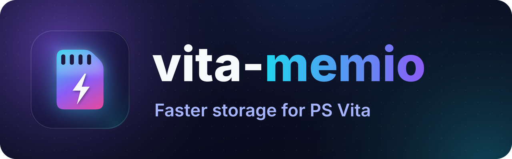

# vita-memio

<p align="center"></p>

**Faster storage for your PS Vita.** vita-memio speeds up a microSD in an **SD2Vita** and the **Sony memory card**: games load quicker, copies and VPK installs take less time. Your files stay exactly as they are.

- **Needs:** HENkaku / Ensō on firmware **3.60–3.74** (tested on a PCH-1000, 3.65).
- **Recommended with** [vita_cpu_tweaks](https://github.com/devnoname120/vita_cpu_tweaks) by devnoname120.
- **Never together with** [Vita Turbo Storage](https://github.com/juanjsebgarcia/vita-turbo-storage), the project vita-memio is forked from.

**[Install](#install)** · **[Problems](#problems)** · **[Download](https://github.com/Osaul4ik/vita-memio/releases/latest)**

## Is it safe?

Games get exactly the same data as without the plugin, and writes are never held back. On any error that storage goes back to the normal way. If the console ever restarts before the plugin has shown it works, the next start loads nothing (*safe mode*); holding **L** at boot skips all plugins. Still, **back up your cards first.**

## Results

PCH-1000, 3.65, microSD in SD2Vita, vita-memio 1.6.0. **Not loading-screen times:** the total time a game waited for the card during one play session (all reads added up), and how long the same reads would have taken without vita-memio's read ahead and memory.

| Game | Waited for the card | Less waiting |
|---|---:|---:|
| Catherine: Full Body (PCSG01179) | 7 s instead of 53 s | **86%** |
| PCSB00404 | 3 s instead of 19 s | **83%** |
| GTA San Andreas (port) | 16 s instead of 39 s | **58%** |
| PCSB00296 | 6 s instead of 12 s | 50% |
| PCSB01257 | 1.4 s instead of 2.5 s | 43% |
| PCSB00867 | 2.9 s instead of 5.0 s | 42% |
| GTA Vice City (port) | 7 s instead of 13 s | 41% |
| Persona 4 Golden (PCSB00245) | 1.7 s instead of 2.6 s | 33% |
| Hatsune Miku: Project DIVA F 2nd (PCSB00554) | 5.4 s instead of 8.0 s | 32% |
| PCSB01007 | 3.0 s instead of 4.4 s | 32% |
| PCSF00007 | 13 s instead of 15 s | 14% |
| Gravity Rush (PCSF00024) | 22 s instead of 23 s | 4% |

You notice it as shorter loading and less stutter. Games that read many tiny pieces gain the most; games that jump around their files gain little.

Tester app, quick profile:

| Test | Without plugin | vita-memio 1.6.0 |
|---|---:|---:|
| Big file, 1 MiB pieces | 14.9 MiB/s | 28.9 MiB/s |
| Big file, 128 KiB pieces | 14.3 MiB/s | 33.0 MiB/s |
| Graphics data, 128 KiB pieces | 19.7 MiB/s | 49.4 MiB/s |
| Random 4 KiB reads | 379 /s | 438 /s |
| Reading small files | 207 files/s | 321 files/s |
| Creating small files | 46 files/s | 113 files/s |

Your card will give other numbers, especially for writes.

## Settings

**Settings → Devices → vita-memio.** You only need to switch on your storage; everything else is already set the way that works best.

| Setting | What it does | Default |
|---|---|---|
| Driver | Loads the plugin at the next start | On |
| Faster SD2Vita / memory card | Speeds up that storage | Off |
| Kernel memory | **Medium** (640 KiB): best for most. **Full** (768 KiB): a little faster when copying between two cards. **Low** (512 KiB): if you get error C1-2569-2. After a restart | Medium |
| GPU-safe reads | **All** if a game shows broken graphics | Non-DMA |
| Overlapped reads · DMA copy · Small transfers too | Faster transfers | Auto · On · On |
| Copy on the system core | Keep at **C + NC R/A** | C + NC R/A |
| Read ahead | **Adaptive** learns per game when it helps | Adaptive |
| Overlay (SELECT + arrows) | In-game menu and HUD | On |
| Profiles for system apps | Own settings for the home screen and system apps | On |
| Verify transfers | Only for testing for errors: slow, 256 KiB more memory | Off |
| Enable log · Statistics | For measuring performance and bug reports | Off |

I use **Full** myself, because my console has enough memory. **Medium** is the default because nobody can know how many other plugins you run.

Press the **Driver: …** row to see the version, the status and the kernel memory used and free.

## Overlay and HUD

- **SELECT + Right:** opens the overlay; again: closes it and shows the HUD. **SELECT + Left:** back. **SELECT + Up/Down:** close all.
- The overlay sets things **for the current game only**; **Save** keeps them. **Tuning** measures your card (kept in `ux0:data/vita-memio/tuning.bin`; Triangle twice measures again).
- The HUD shows read/write speed, read ahead per memory kind, and how much of the copying the DMA chip did (near 100% is normal).

## Tester

`vitamemio_tester.vpk` (optional) measures your own card, every byte checked. Results are added to `ur0:data/vita-memio/results.txt`. It never changes the plugin's settings.

## Good to know

- Only the storages you switch on are touched: never internal storage, game cards, USB or Wi-Fi.
- Memory: 512–768 KiB by *Kernel memory*, plus about 40 KiB each for *Read ahead* and the *Overlay*.
- Before a restart or power off, every storage goes back to the normal way, so the cards are shut down cleanly.
- PSP games in Adrenaline and emulators are sped up too.

## Install

1. Download `vita-memio-<version>.zip` from the [latest release](https://github.com/Osaul4ik/vita-memio/releases/latest) and unpack it. (`…-more_logs.zip` is the same plugin with detailed statistics in its log, for testers.)
2. Copy `vitamemio_kernel.skprx`, `vitamemio_hud.skprx` and `vitamemio.suprx` to **`ur0:tai/`**.
3. In VitaShell, edit **`ux0:tai/config.txt`** (or `ur0:tai/config.txt` if there is none on ux0) and add:

   ```
   *KERNEL
   ur0:tai/vitamemio_kernel.skprx

   *NPXS10015
   ur0:tai/vitamemio.suprx
   ```

   If `*KERNEL` or `*NPXS10015` is already there, put the line under it instead. `vitamemio_hud.skprx` is **not** added: the plugin loads it itself.
4. Restart, open **Settings → Devices → vita-memio** and switch on your storage. The row under the title should say **Driver: active**.

## Update

1. Switch **Driver** off and restart.
2. Replace all **three** files in `ur0:tai/`.
3. Delete `ur0:data/vita-memio/` and `ux0:data/vita-memio/`.
4. Restart and switch your storage on again.

## Uninstall

Switch **Driver** off, remove the lines from `config.txt`, restart, then delete the three files and both `vita-memio` folders.

## Problems

- **Error C1-2569-2** (out of kernel memory): close one of two open apps (e.g. VitaShell and Settings), hide the HUD, switch off *Verify*, *Enable log* and *Statistics*. Still there: *Kernel memory* → **Low**, restart.
- **Driver: safe mode:** undo what you changed last, press **Reset safe mode**, restart.
- **Driver: not loaded** / no vita-memio page: check the files in `ur0:tai/` and the lines in `config.txt`.
- **Broken graphics in a game:** *GPU-safe reads* → **All**. (No graphical issues were observed during an hour of testing. The switch is included just in case.)
- **Anything else:** switch on *Enable log*, reproduce, and attach `ur0:data/vita-memio/kernel.log` to an [issue](https://github.com/Osaul4ik/vita-memio/issues).

## Disclaimer

Provided **"as is", without warranty of any kind**; you use it at your own risk. **Back up your cards before installing.** See the [MIT License](LICENSE).

## For developers

`make build` (modules and tester, pinned VitaSDK Docker image), `make test` (host tests), `make config`. `make build VM_DIAG=OFF` leaves the log's session statistics out; the release workflow builds both archives. See [CONTRIBUTING.md](CONTRIBUTING.md).

## Credits

All credit for the original project goes to **[Juan Garcia Alvite](https://github.com/juanjsebgarcia)**, author of [Vita Turbo Storage](https://github.com/juanjsebgarcia/vita-turbo-storage): the technique, the research and the original implementation.

- **Built on:** [taiHEN](https://github.com/yifanlu/taiHEN) (Yifan Lu), [HENkaku](https://github.com/henkaku/henkaku) and [Ensō](https://github.com/TheOfficialFloW/enso) (HENkaku team, TheFloW), [VitaSDK](https://vitasdk.org).
- **Ideas:** [IOStaging](https://github.com/bythos14) (bythos14), [YAMT](https://github.com/SKGleba/yamt-vita) (SKGleba, Devices page layout names), [PSVshell](https://github.com/Electry/PSVshell) (Electry, the look of the tester and HUD). No YAMT or PSVshell code is used.
- **Included:** a subset of [Terminus Font](https://terminus-font.sourceforge.net/) (Dimitar Toshkov Zhekov, SIL OFL 1.1). Artwork drawn by `tools/gen_art.py`, lettering in [Inter](https://rsms.me/inter/) (Rasmus Andersson, SIL OFL 1.1).

## License

MIT, as the original project: see [LICENSE](LICENSE). The Terminus Font subset in `include/vm_font_terminus.h` stays under the SIL Open Font License 1.1.
